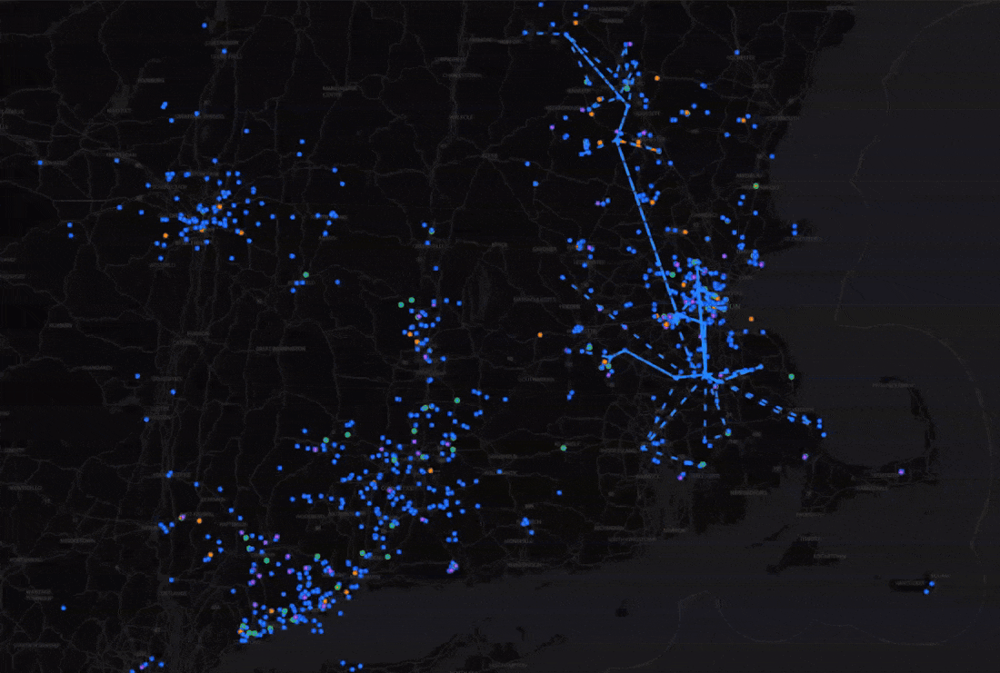

<h1 align="center">MeshCore Live Map</h1>

<p align="center">
  Watch your MeshCore network in real time.<br />
  Self-hosted nodes, routes, activity, and radio-planning tools powered by MQTT.
</p>

<p align="center">
  <a href="https://github.com/yellowcooln/meshcore-mqtt-live-map/releases"></a>
  <a href="https://github.com/yellowcooln/meshcore-mqtt-live-map/actions/workflows/tests.yml?query=branch%3Amain"></a>
  <a href="https://github.com/yellowcooln/meshcore-mqtt-live-map/actions/workflows/docker-publish.yml?query=branch%3Amain"></a>
  <a href="https://hub.docker.com/r/yellowcooln/meshcore-mqtt-live-map"></a>
</p>

<p align="center">
  <a href="https://map.newenglandme.sh/">Live demo</a> &middot;
  <a href="#quick-start">Quick start</a> &middot;
  <a href="./docs.md">Documentation</a> &middot;
  <a href="#configuration">Configuration</a> &middot;
  <a href="./VERSIONS.md">Changelog</a> &middot;
  <a href="https://github.com/yellowcooln/meshcore-mqtt-live-map/issues">Report an issue</a>
</p>



## Features

- Live node markers, explicit device roles, node search, and MQTT presence indicators.
- Animated routes with 1-, 2-, and 3-byte hop prefixes, path filters, and packet details.
- Activity heatmaps, optional trails, retained route history, and incoming/outgoing peer statistics.
- Line-of-sight profiles and propagation tools for exploring terrain and antenna placement.
- Optional MeshMapper or legacy coverage layers, plus radar and wind overlays.
- Light, dark, topo, and satellite maps, shareable views, contact QR codes, and installable PWA support.
- Persistent state, optional automatic backups, customizable site metadata, and subpath hosting.

Routes come from decoded packet paths, not a survey of every possible RF link. Missing coordinates, missing hops, and ambiguous short prefixes can prevent lines from being drawn. Planning tools provide estimates, not guaranteed radio coverage.

## Quick start

### Run the prebuilt Docker image

Images are available on [Docker Hub](https://hub.docker.com/r/yellowcooln/meshcore-mqtt-live-map). No local build is required:

- `yellowcooln/meshcore-mqtt-live-map:latest`: production image from `main`.
- `yellowcooln/meshcore-mqtt-live-map:dev`: development image from `dev`.

Install Docker with the Compose plugin and prepare a new directory:

```bash
mkdir meshcore-mqtt-live-map
cd meshcore-mqtt-live-map
curl -fsSL https://raw.githubusercontent.com/yellowcooln/meshcore-mqtt-live-map/main/.env.example -o .env
```

Edit `.env` before starting:

1. Set your MQTT broker, credentials, transport, TLS settings, and subscription topic.
2. Set `MAP_START_LAT`, `MAP_START_LON`, `MAP_START_ZOOM`, and the geographic boundary for your mesh. `MAP_RADIUS_KM=0` disables radius filtering; the template otherwise starts around Boston.
3. Set your site title and public URL. For public hosting, review `PROD_MODE`, a new `PROD_TOKEN`, and optional Turnstile settings. Do not use the template token for production.

In Docker, `MQTT_HOST=localhost` points at the map container, not your host. Use a reachable broker hostname/IP or a service name on a shared network. With `meshcore-mqtt-broker`, normally use a subscriber account rather than node publisher credentials. See the [setup guide](./howto.md).

Create `docker-compose.yaml` alongside `.env`:

```yaml
services:
  meshmap:
    image: yellowcooln/meshcore-mqtt-live-map:latest
    ports:
      - "${WEB_PORT:-8080}:8080"
    env_file:
      - .env
    volumes:
      - ./data:/data
      - ./backup:/backup
    healthcheck:
      test: ["CMD", "python", "-c", "import urllib.request; urllib.request.urlopen('http://127.0.0.1:8080/health', timeout=3).read()"]
      interval: 30s
      timeout: 5s
      retries: 3
      start_period: 30s
    restart: unless-stopped
```

Pull and start:

```bash
docker compose pull meshmap
docker compose up -d --no-build meshmap
```

Open **http://localhost:8080**, or use your server's address and configured `WEB_PORT`.

The healthcheck detects MQTT or broadcaster failures, but Docker Compose does not restart a container solely because it becomes unhealthy. Automatic recovery from those failures needs an orchestrator or separate recovery policy.

### Build from source instead

```bash
git clone https://github.com/yellowcooln/meshcore-mqtt-live-map.git
cd meshcore-mqtt-live-map
cp .env.example .env
```

Configure `.env` as above, then use the repository's build-based Compose file:

```bash
docker compose up -d --build meshmap
```

Additional examples: [image-based Compose](./deploy/docker-compose.image.yaml), [Docker Swarm](./deploy/swarm-stack.yaml), and [Kubernetes](./deploy/kubernetes-meshmap.yaml). The Compose file in `deploy/` uses paths relative to that directory; adjust them before copying it to a different location.

## Configuration

See [`.env.example`](./.env.example) for template values, the [setup guide](./howto.md) for deployment, and the [configuration reference](./docs.md#configuration-reference) for detailed settings.

| Setting | Purpose |
| --- | --- |
| `MQTT_HOST`, `MQTT_PORT`, `MQTT_USERNAME`, `MQTT_PASSWORD` | Broker address and subscriber credentials. |
| `MQTT_TRANSPORT`, `MQTT_WS_PATH`, `MQTT_TLS`, `MQTT_CA_CERT` | TCP/WebSocket and TLS settings. Keep `MQTT_TLS_INSECURE=false` normally. |
| `MQTT_TOPIC` | Subscription topic; comma-separated subscriptions are supported. |
| `SITE_TITLE`, `SITE_URL`, `SITE_ICON` | Site identity, public URL, and icon. |
| `MAP_START_LAT`, `MAP_START_LON`, `MAP_START_ZOOM` | Initial map view. |
| `MAP_RADIUS_KM`, `MAP_BOUNDARY_MODE`, `MAP_BOUNDARY_FILE` | Radius or polygon filtering. |
| `MAP_DEFAULT_LAYER`, `DISTANCE_UNITS` | Starting map layer and km/mi units. |
| `PROD_MODE`, `PROD_TOKEN`, `TURNSTILE_ENABLED` | Production access controls and optional visitor verification. |
| `ROUTE_HISTORY_ENABLED`, `ROUTE_HISTORY_HOURS` | Route-history visibility and retention. Peers remain independent. |
| `COVERAGE_API_URL`, `COVERAGE_API_KEY`, `COVERAGE_API_KEYS` | Optional coverage integration and MeshMapper keys. |
| `WEATHER_RADAR_ENABLED`, `WEATHER_WIND_ENABLED` | Optional weather layers. |
| `BACKUP_ENABLED`, `BACKUP_INTERVAL_SECONDS`, `BACKUP_RETENTION_DAYS` | Automatic state backups; disabled in the template. |

Dark maps use keyless OpenFreeMap. CARTO is optional for satellite labels and server-generated dark social previews, not a prerequisite for the interactive dark map. See [optional CARTO configuration](./howto.md#optional-carto-key-for-satellite-labels-and-dark-previews).

**Production authentication:** Turnstile is active only with `PROD_MODE=true`. Its browser authentication covers map/WebSocket sessions; protected API endpoints still require `PROD_TOKEN`. A browser verification cookie is not an API credential. See [production access](./docs.md#production-token).

## Updates and persistence

Keep `./data` and `./backup` mounted, and preserve `.env`, operator overrides, and custom assets. Back up configuration and state before upgrading. Do not overwrite working settings with the template.

For a prebuilt-image installation:

```bash
docker compose pull meshmap
docker compose up -d --no-build --pull never --force-recreate meshmap
```

For source builds, select the intended source revision, build with `docker compose build meshmap`, then use the same recreation command. A plain `docker compose restart` does not reload Compose env-file values.

Do not bind-mount a copied `app.py` over the image's `/app/app.py`; whole-file overrides hide future packaged fixes. Review existing overrides before every upgrade.

Check logs and health without publishing test traffic:

```bash
docker compose logs --tail=100 -f meshmap
curl -fsS http://localhost:8080/health
```

A broker connection alone does not prove useful data is arriving. Confirm node metadata and packet activity advance. In production mode, include the configured token when querying protected data endpoints.

## Documentation

- [Setup and broker guide](./howto.md)
- [Feature, configuration, and API reference](./docs.md)
- [Architecture](./ARCHITECTURE.md)
- [Contributing](./CONTRIBUTING.md)
- [Privacy](./PRIVACY.md)
- [Release history](./VERSIONS.md)

For automated source checks:

```bash
pip install -r requirements-dev.txt
npm ci --prefix backend
pytest -q
```

## Community maps

- [Greater Boston](https://live.bostonme.sh/)
- [New England](https://map.newenglandme.sh/)
- [CTMesh](https://meshcore-map.ctmesh.org/)
- [West Coast Mesh](https://livemap.wcmesh.com/)
- [Utah Mesh](https://map.mwmesh.com/)
- [Aus Eastern Mesh](https://map.eastmesh.au/)
- [Czech Republic](https://mapa.meshcore.cz/)
- [Bayreuth](https://map.meshcorebayreuth.de/)
- [Southern Poland](https://mcmap.cheaterenator.trade/)

Community deployments may run different versions and configurations.

Running a map for your mesh? If you'd like it listed here, [open an issue](https://github.com/yellowcooln/meshcore-mqtt-live-map/issues/new) with your mesh name and map URL.

## About these projects

I build these projects with the help of AI when I see a need for software I want to use myself. The goal is to make something useful, run it on my own systems, and share it with anyone else who might find it helpful.

This is something I do for fun, in my free time outside of work and family. If you find these tools useful and would like to support the time that goes into them, a little support on [Ko-fi](https://ko-fi.com/yellowcooln) is always appreciated. No pressure. Using the software, reporting bugs, and contributing ideas helps too.

## Star History

<a href="https://www.star-history.com/?repos=yellowcooln%2Fmeshcore-mqtt-live-map&type=date&legend=top-left">
 <picture>
   <source media="(prefers-color-scheme: dark)" srcset="https://api.star-history.com/chart?repos=yellowcooln/meshcore-mqtt-live-map&type=date&theme=dark&legend=top-left" />
   <source media="(prefers-color-scheme: light)" srcset="https://api.star-history.com/chart?repos=yellowcooln/meshcore-mqtt-live-map&type=date&legend=top-left" />
   
 </picture>
</a>
